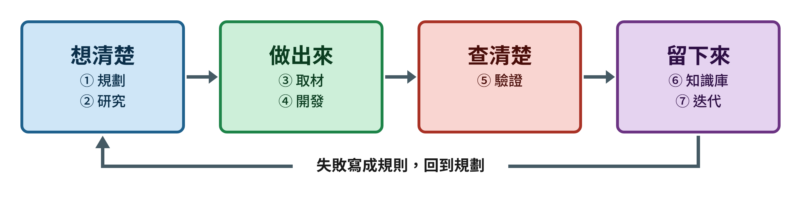
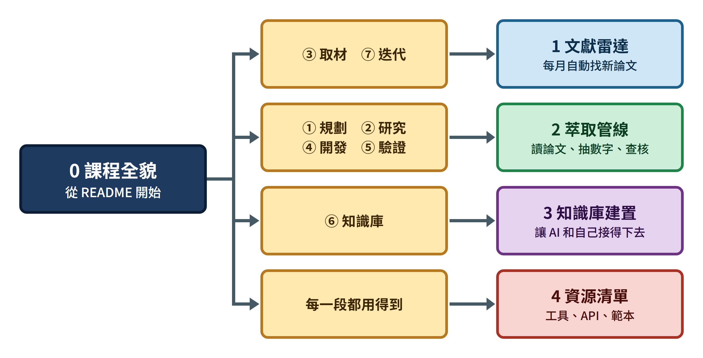
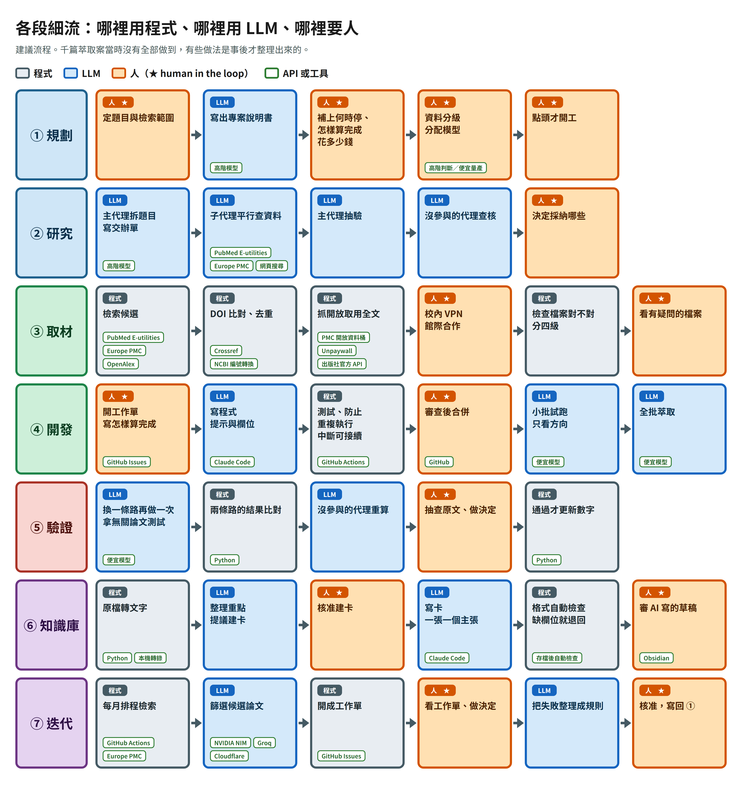

# 讓你的 Agent 從會說到會做

> 台大職能治療學系 AI 講座第五場配套資源。教你怎麼用 AI **規劃並做完一個完整專案**，以及怎麼讓結果可以相信。

| 講座資訊 | |
|---|---|
| 講者 | 葉淨維 博士生 |
| 日期 | 2026 年 12 月 2 日（三） |
| 時間 | 12:00–13:10 |
| 地點 | 公衛 431 教室（另有線上參加） |

## 一個循環

AI 可以很快做完很多事。結果能不能相信，靠的是**計畫、查核，以及把每次失敗寫成規則**。

## 這裡有什麼

| 編號 | 資料夾 | 你可以拿去做什麼 | 適合誰先看 |
|---|---|---|---|
| 1 | [文獻雷達](1-literature-radar/README.md) | 每月自動找新論文、篩選、開成工作單；換成你的題目只改一個設定檔 | 想持續追文獻的人 |
| 2 | [萃取管線](2-extraction-pipeline/README.md) | 把「大量讀論文、抽數字、查核」的六個階段照著做一次 | 做系統性回顧的人 |
| 3 | [知識庫建置](3-knowledge-base/README.md) | 下載一個可以直接開始用的 Obsidian 知識庫，附 SOP 與給 AI 用的指令 | 想整理自己資料的人 |
| 4 | [所需資源清單](4-resources/README.md) | 工具、帳號、API、費用，哪些必要、哪些選用 | 所有人 |
| — | [資源手冊](handbook/README.md) | Chat 與 Agent、資料安全、本機模型、學習地圖、名詞小辭典 | 想補基礎的人 |

## 每一段在做什麼

顏色代表誰在做：**灰色是程式**（規則固定，每次結果一樣）、**藍色是 LLM**（會讀、會寫，也會錯）、**橘色是人**（★ 一定要人看過）。
單段放大版：[規劃](diagrams/04_flow_1_plan.png)、[研究](diagrams/04_flow_2_research.png)、[取材](diagrams/04_flow_3_sources.png)、[開發](diagrams/04_flow_4_develop.png)、[驗證](diagrams/04_flow_5_verify.png)、[知識庫](diagrams/04_flow_6_knowledge_base.png)、[迭代](diagrams/04_flow_7_iterate.png)。

這是建議流程。講座案例（千篇論文萃取）當時沒有全部做到，有些做法是事後整理出來的。

## 從哪裡開始

1. 先看[資源手冊的資料分級與安全](handbook/README.md#資料分級與安全)，把手邊資料分一次級。不確定就當敏感資料。
2. 不寫程式：用 PubMed 的 Create alert 開始（[手冊說明](handbook/README.md#自動檢索不寫程式也能開始)）。
3. 想整理自己的資料：下載 [3 知識庫建置](3-knowledge-base/README.md)，照第一天的 SOP 做 30 分鐘。
4. 想追文獻：照 [1 文獻雷達](1-literature-radar/README.md) 的 A 段，在自己電腦跑一次，不用金鑰。
   想先看成品：這個 repo 自己也在跑雷達，每月 1 號用職能治療四個主題（中風上肢、中風職能治療、失智症職能治療、長者跌倒預防）檢索，結果開成標籤為 [`literature-radar` 的 Issue](https://github.com/matt-ye/ot-ai-resources/issues?q=label%3Aliterature-radar)。設定在 `.github/workflows/literature-radar.yml`，和範本只差在程式留在 `1-literature-radar/` 裡。

### 怎麼下載

按綠色 **Code** 按鈕 → **Download ZIP** → 解壓縮。不需要會 Git。

## 使用前請知道

- 病人資料、學生成績、未發表研究、受試者資料，**不要放進雲端 AI**。
- AI 產出的內容都當草稿，人看過才算數。
- 第三方服務的額度、價格與條款會變，以官方頁為準。
- 部分文字由 AI 協助起草，經人工審閱。

## API 金鑰一律不上傳

金鑰（API key、token）就是通行密碼，誰拿到誰就能用你的額度，甚至用你的名義呼叫服務。**任何金鑰都不得寫進會上傳的檔案**，包括程式、設定檔、README、Issue、截圖與聊天紀錄。

| 在哪裡用 | 金鑰放哪裡 | 怎麼做 |
|---|---|---|
| 自己電腦 | `.env` 檔 | 把 `.env.example` 複製成 `.env`，填上金鑰。本 repo 的 `.gitignore` 已排除 `.env`，用 git 指令時不會被加入 |
| GitHub 自動執行 | GitHub 的 Secret | 見下方步驟 |

**在 GitHub 存成 Secret**（以文獻雷達的 Groq 金鑰為例）

1. 打開你自己的 repo（不是這個 repo）→ 上方 **Settings**。
2. 左側 **Secrets and variables** → **Actions**。
3. 按 **New repository secret**。
4. **Name** 填 `GROQ_API_KEY`。名稱要和 `.env.example` 裡的完全一樣，大小寫也要一樣，自動執行的設定檔才讀得到。
5. **Secret** 貼上金鑰本身，前後不要有空格或引號 → **Add secret**。
6. 其他金鑰照做：`NVIDIA_API_KEY`、`CF_ACCOUNT_ID`、`CF_API_TOKEN`。

存好之後，連你自己也看不到內容，只能覆寫或刪除。自動執行時，GitHub 會把它交給程式，並在執行紀錄裡遮成 `***`。

**容易出錯的地方**

- **網頁上傳不看 `.gitignore`。** 用拖拉方式上傳資料夾前，先把 `.env` 移走。
- **不要把金鑰貼進 Issue 或討論區問問題。** 要給別人看錯誤訊息時，先把金鑰那段刪掉。
- **一個用途申請一把**，能設到期日與最小權限就設（例如 Cloudflare 只給 Workers AI 權限）。
- **已經傳上去了**：立刻到服務商網站撤銷那把金鑰，再申請新的。只刪檔案沒有用，舊版本的紀錄裡還看得到。

## 授權

- 程式碼：[MIT](LICENSE)。包含 `.py`、`.ps1`、`.yml`、設定用的 `.json` 與測試
- 文件、圖與範例內容：[CC BY-NC 4.0](LICENSE-docs)。包含 `.md`、`.csv`、圖、示範卡與 SOP

發現錯誤或連結失效，歡迎在本 repo 開 Issue。
